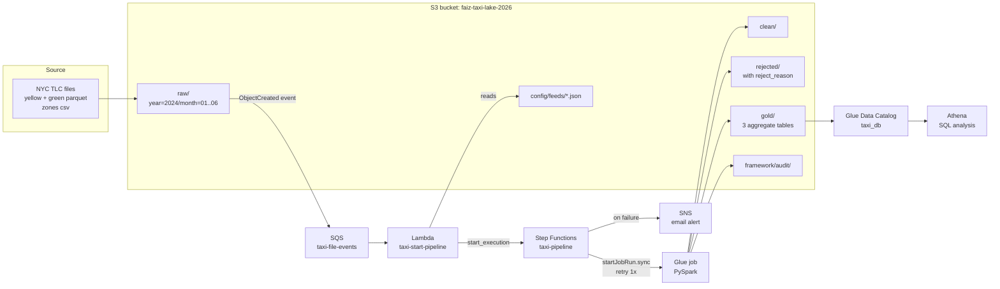

# NYC Taxi Data Lake on AWS

An end-to-end, event-driven data lake on AWS, built as a personal learning project.
It takes about **20 million** real NYC yellow taxi trips (Jan to Jun 2024), cleans them with **AWS Glue (PySpark)**,
stores them in **S3** in raw / clean / gold layers, and makes them queryable with **Athena**.
A new file landing in S3 starts the whole pipeline on its own, and a failure sends an email alert.

**Tech:** S3 · Glue (PySpark) · Glue Data Catalog · Athena · Lambda · SQS · Step Functions · SNS · IAM · AWS CLI · AWS Budgets

---

## 1. The problem

Raw taxi files are big, messy and not ready for analysis:

- some trips have 0 passengers, 0 distance, negative amounts, or drop-off before pick-up
- some rows are duplicates
- zone names are in a separate lookup file
- analysts want simple answers ("which zones earn the most?", "busiest hour?") without scanning 20M rows every time

**Goal:** build a pipeline that cleans the data, keeps bad rows for checking, creates small gold tables for reporting,
runs automatically when new files arrive, and is easy to extend to new data feeds.

---

## 2. Architecture



**Flow in simple words**

1. A new file is uploaded under `raw/<feed>/...` in S3.
2. S3 sends an event to an **SQS** queue (a waiting line, so no event is lost).
3. **Lambda** reads the message, finds the feed name from the path, checks that `config/feeds/<feed>.json` exists,
   and starts **Step Functions** once per feed.
4. **Step Functions** runs the **Glue** job and waits for it. If it fails, it retries once after 60 seconds.
   If it fails again, it sends an **SNS** email and stops with a Fail state.
5. **Glue** cleans the data and writes clean / rejected / gold layers to S3, plus an audit row.
6. **Athena** queries the gold tables with plain SQL.

---

## 3. Repo structure

```
aws-taxi-data-lake/
├── README.md
├── glue/
│   ├── taxi_raw_to_clean.py        # main ETL: raw -> clean / rejected -> gold
│   └── taxi_feed_framework.py      # config-driven job, works for any feed
├── lambda/
│   └── lambda_function.py          # SQS -> Step Functions
├── stepfunctions/
│   └── taxi-pipeline.asl.json      # Glue .sync + Retry + Catch -> SNS -> Fail
├── configs/feeds/
│   ├── yellow_trips.json
│   ├── taxi_zones.json             # csv feed, same job
│   ├── green_trips.json            # onboarded with zero code change
│   └── broken_feed.json            # used to test the failure alert
├── sql/
│   ├── 01_create_tables.sql        # Athena DDL + MSCK REPAIR
│   └── 02_analysis_queries.sql     # business queries + partition pruning demo
├── infra/
│   └── setup.sh                    # CloudShell commands to build everything
└── docs/
    ├── day11-taxi-end-to-end-project.md   # full step-by-step guide
    ├── interview-script.md
    └── cleanup-checklist.md
```

---

## 4. What each part does

### 4.1 Storage layers (S3)

| Layer | Path | What is inside |
|-------|------|----------------|
| Raw | `raw/yellow_trips/year=2024/month=01..06/`, `raw/green_trips/`, `raw/taxi_zones/` | Files exactly as downloaded |
| Clean | `clean/yellow_trips/` (partitioned by year, month) | Good rows, deduped, with new columns |
| Rejected | `rejected/yellow_trips/` | Bad rows + a `reject_reason` column |
| Gold | `gold/daily_zone_revenue/`, `gold/hourly_demand/`, `gold/payment_tips/` | Small summary tables for reports |
| Framework | `framework/clean/<feed>/`, `framework/audit/` | Output of the config-driven job + one audit row per run |
| Config | `config/feeds/<feed>.json` | One JSON per feed |

### 4.2 Main Glue job: `taxi-raw-to-clean`

- Spark script job, 3 × G.1X workers, 30 min timeout. Parameters: `--BUCKET` (`s3://faiz-taxi-lake-2026`), `--MONTH` (`all` or one month like `03`).
- **Data quality:** each bad row gets a reason: `no_passengers`, `zero_distance`, `bad_amount`, `bad_time`, `wrong_year`.
  Bad rows go to `rejected/`, not deleted, so they can be checked later.
- **Dedupe** on the trip key columns.
- **Broadcast join** with the small zones lookup (265 rows) so Spark does not shuffle 20M rows.
- **New columns:** `pickup_date`, `pickup_hour`, `weekday`, `trip_minutes`, `speed_mph`, `tip_pct`, `is_airport`, `payment`.
- **Dynamic partition overwrite:** re-running one month replaces only that month's folder.
- `is_airport` = the trip paid an airport fee. `payment` = card / cash / other.
- **Rejected rows** are written partitioned by month. **Clean** is `repartition("year","month")` then `partitionBy`, so one file per month.
- **3 gold tables:** daily revenue per zone; trips and average minutes per weekday + hour + airport; trips and average tip % per month + payment.

### 4.3 Config-driven framework: `taxi-feed-framework`

One generic Glue job. It reads `config/feeds/<FEED>.json` with boto3:

```json
{
  "feed_name": "green_trips",
  "source_path": "raw/green_trips/",
  "format": "parquet",
  "required_columns": ["lpep_pickup_datetime", "total_amount"],
  "dedupe": true,
  "partition_by": ["year", "month"],
  "target_path": "framework/clean/green_trips/"
}
```

Then it does read → required-column check → dedupe → add `_loaded_at` → write → audit row.
**Green taxi data (Jan 2024, 56,551 rows) was added with only a new JSON file and no code change.**

### 4.4 Automation

- **S3 → SQS:** event on `ObjectCreated` for prefix `raw/`. Queue policy allows only S3 from this bucket.
  Visibility timeout 300 s (longer than the Lambda timeout).
- **Lambda (python3.12):** `feed = key.split("/")[1]`, uses a `set()` so 6 files of one feed start only 1 run,
  `head_object` to skip feeds with no config.
- **Step Functions (Standard):** `glue:startJobRun.sync` with `"--FEED.$": "$.feed"`, Retry 1 after 60 s,
  Catch → SNS publish → Fail.
- **Failure test:** `broken_feed.json` points to a text file named `bad.parquet` → Glue cannot read it → retry after 60 s → fails again → "Taxi pipeline FAILED" email received → execution ends red.

### 4.5 Security and cost control

- 3 IAM roles made with the CLI, each with only what it needs:
  `taxi-glue-role` (AWSGlueServiceRole + this bucket only), `taxi-sfn-role` (start/watch Glue jobs + publish to one SNS topic),
  `taxi-lambda-role` (one queue, config read, start one state machine).
- S3 public access blocked.
- AWS Budgets: $35 monthly budget + zero-spend alert.

---

## 5. Results

Top pickup zones by revenue (Jan to Jun 2024, from `gold_daily_zone_revenue`):

| Zone | Trips | Revenue | Revenue per trip |
|------|------:|--------:|-----------------:|
| JFK Airport | ~860K | ~$71M | ~$82 |
| LaGuardia Airport | ~616K | ~$42M | ~$68 |
| Midtown Center | ~870K | ~$21.7M | ~$25 |

**Insight:** Midtown has the most trips, but airports earn far more per trip, so airports bring the most revenue.

Other numbers (fill in from your own runs):

| Metric | Value |
|--------|------:|
| Raw rows (yellow, 6 months) | ~20M |
| Clean rows | `<CLEAN_ROWS>` |
| Rejected rows | `<REJECTED_ROWS>` (top reason: `<TOP_REASON>`) |
| Partition pruning: data scanned, all months vs one month | `<ALL_MB>` MB vs `<ONE_MB>` MB |

---

## 6. Cost

| Item | Value |
|------|------:|
| Main Glue job run | 2 min 9 s, 3 DPUs, ~0.11 DPU-hours ≈ **$0.05** per run |
| Lambda, SQS, SNS, Step Functions | inside free tier for this volume |
| Athena | $5 per TB scanned; gold tables are tiny, and partition filters cut scans |
| Total project spend | `<TOTAL_SPEND>` (check Billing) |

---

## 7. Problems I hit and how I fixed them

| Problem | Cause | Fix |
|---------|-------|-----|
| Job failed with `DIVIDE_BY_ZERO` | Newer Glue versions run Spark with ANSI mode on, so `x / 0` throws an error instead of null | Wrapped `speed_mph` and `tip_pct` in `F.when(denominator > 0, ...)` |
| 48 small files in `clean/` | Each Spark task wrote its own file in every partition | `repartition("year", "month")` before `partitionBy` → 1 file per month |
| Re-running one month deleted other months | Default overwrite replaces the whole folder | `partitionOverwriteMode = dynamic` |
| Many files could start many runs | S3 sends one event per file | `set()` in Lambda → one run per feed per batch |

---

## 8. What I would add next

- **Dead-letter queue (DLQ)** on SQS so messages that keep failing are kept, not lost.
- **Apache Iceberg** tables for ACID updates, MERGE and time travel.
- **Snowflake** as the serving layer (load gold tables with Snowpipe or COPY INTO).
- **CI/CD** with GitHub Actions: lint + unit tests for PySpark, then deploy scripts and the state machine.
- **Infrastructure as code** (Terraform or CloudFormation) instead of a shell script.
- **Glue job bookmarks** or file tracking for true incremental loads.
- **Data quality** with Glue Data Quality rules and a dashboard on the audit table.

---

## 9. How to run it

1. Install the AWS CLI and run `aws configure` (region `ap-southeast-2`).
2. Download the NYC TLC files (yellow Jan to Jun 2024, green Jan 2024, zone lookup CSV) into `data/`.
3. `ALERT_EMAIL=you@example.com bash infra/setup.sh`
4. Confirm the SNS email.
5. Run `sql/01_create_tables.sql` in Athena, then start `taxi-raw-to-clean`.
6. Upload a new file under `raw/green_trips/` and watch Step Functions start by itself.
7. When done, follow [`docs/cleanup-checklist.md`](docs/cleanup-checklist.md).

Data source: [NYC Taxi & Limousine Commission trip record data](https://www.nyc.gov/site/tlc/about/tlc-trip-record-data.page).
